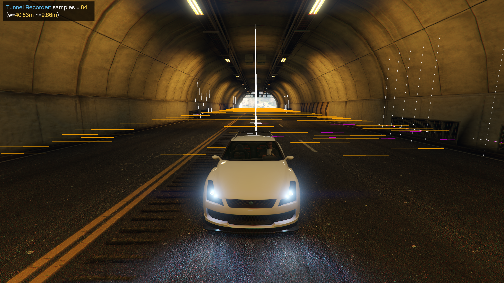
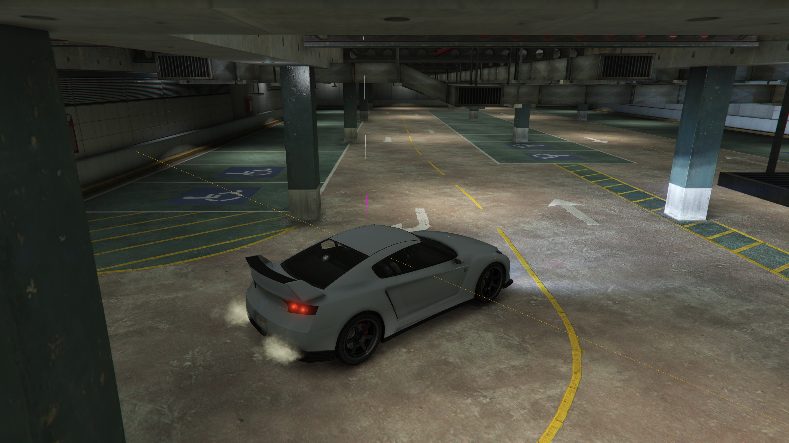

# Adding Tunnels

Realistic Vehicle Radio includes a powerful built-in **Tunnel Recorder** that allows you to map out any tunnel, underpass, or canyon in the game. The recorded data is used by the script's highly-optimized spatial-hashing grid to mute the radio accurately.

There are two ways to add tunnels: **Automatic Recording** and **Manual Recording**.

## Method 1: Automatic Recording (Drive-Through)
This is the fastest way to record long tunnels and highways.

1. **Set a Name (Optional):** Open the menu (**F3**) -> *Tunnel Recorder* -> *Next Tunnel Name* to give your tunnel a custom name (e.g., "Del Perro Tunnel").
2. **Start Recording:** Get in a vehicle, enter the tunnel, and press **F7**. You will see a notification that recording has started.
3. **Drive Through:** Drive through the tunnel at a normal speed. The script automatically samples points based on your distance traveled and steering angle.
4. **Stop & Save:** Once you exit the tunnel, press **F7** again. The script will automatically save the tunnel to your JSON file.

## Method 2: Manual Recording (Point-by-Point)
Use this method for precise adjustments and complex intersections.

1. Open the menu (**F3**) -> *Tunnel Recorder* -> **Manual Recording**.
2. Check the **"Enable Manual Recording"** box. *(Note: Automatic recording is disabled while this is active to prevent data corruption).*
3. Position your vehicle exactly where you want the first point.
4. Click **"Add Point"**. You will see a preview of the tunnel walls around your car.
5. Move the vehicle to the next position and click **"Add Point"** again.
6. Use **"Delete Previous Point"** if you make a mistake.
7. Once finished (minimum 2 points required), click **"Save Changes"**.

## 💡 Tips for Best Results
- **Keep it Simple:** You do not need a point every 0.5 meter. The spatial-hashing grid is highly accurate. A `Min Distance` of **1.0m to 2.0m** in the settings is perfect for most of tunnels and keeps your JSON file moderately sized and performant.
- **Use Debug Mode:** Always press **F6** while recording so you can visually confirm the walls are hitting the correct concrete boundaries and not clipping into the road.
- **Disbale vehicles and peds:** Always disable them, as they can interfere with the recorded data. I recommend using Menyoo.