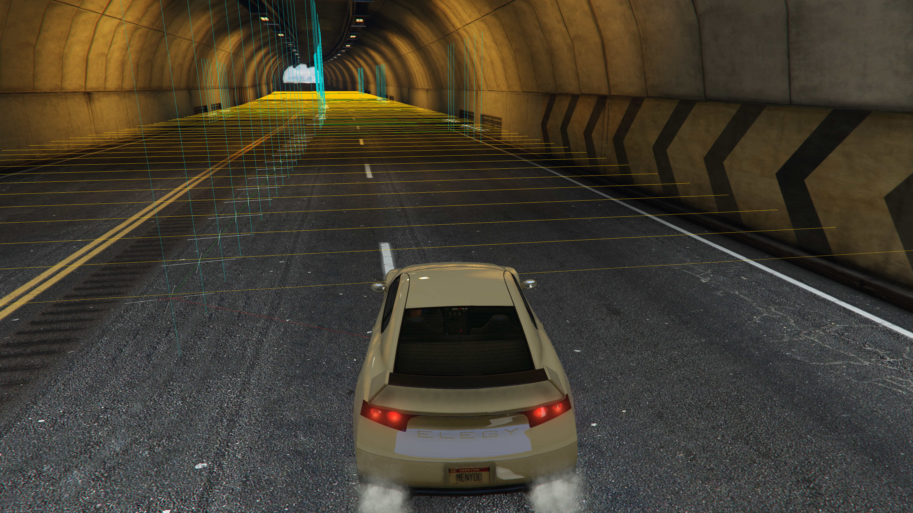
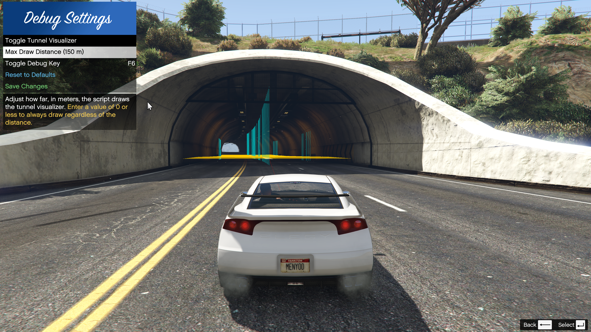

# Debug Mode & Visualizer

The **Debug Visualizer** is an essential tool for mapping tunnels and troubleshooting detection issues. It draws the exact mathematical boundaries the script uses to determine if a vehicle is inside a tunnel.

## How to Enable
- Press **F6** (default) to toggle Debug Mode ON or OFF.

## Understanding the Visuals

When Debug Mode is active, the script draws several overlays:

1. **Saved Tunnel Boundaries:** Draws the walls, floor, and ceiling of all saved tunnels within your `Max Draw Distance`.
2. **Live Recording Trail:** When recording with **F7**, newly captured points are drawn in bright Magenta/Orange so you can see your path in real-time.
3. **Manual Preview:** When Manual Recording is enabled, a wireframe box is drawn around your current vehicle to show exactly where the walls will be placed if you click "Add Point".
4. **Vehicle Projection Lines:** Draws lines from player vehicle to the tunnel segments they are currently being tested against. This proves the **Spatial Hashing Grid** is working correctly by showing that the script only calculates nearby segments, not the whole map!

## Performance & Settings

While the **tunnel detection logic** is heavily optimized and costs virtually zero FPS, drawing thousands of lines on the screen *can* cause minor frame drops on lower-end PCs.

If you experience FPS drops while using Debug Mode:
1. Open the menu (**F3**) -> **Debug Settings**.
2. Lower the **Max Draw Distance** (Default is `150m`. Try lowering it to `50m` or `80m`).
3. Press **Save Changes**.
