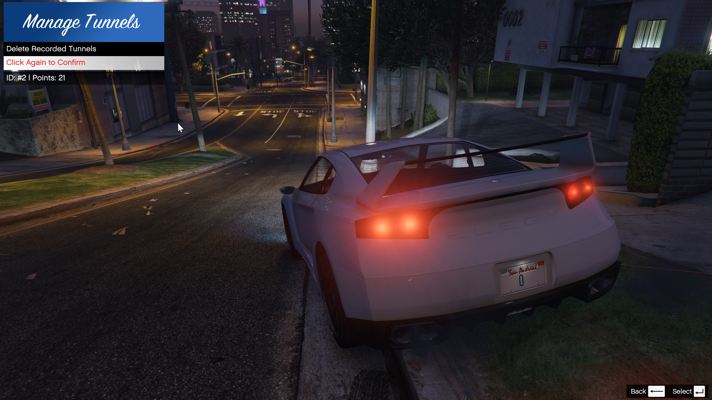

# Deleting Tunnels

If you made a mistake while recording, or if you want to clean up old test tunnels to keep your JSON file lightweight, you can easily delete them using the in-game menu.

## How to Delete a Tunnel

1. Press **F3** to open the main menu.
2. Navigate to **Manage Tunnels**.
3. You will see a list of all currently loaded tunnels, displaying their **Name**, **ID**, and **Point Count**.
4. Select the tunnel you want to delete and press **Enter**.
5. **Confirmation Step:** To prevent accidental deletions, the item title will change to red: `"Click Again to Confirm"`.
6. Press **Enter** a second time to permanently delete the tunnel from your save file.

## Managing File Size
Deleting unused or poorly recorded tunnels (e.g., tunnels with 500+ points recorded at 0.5m intervals) is highly recommended. While the script's **Spatial Hashing Grid** ensures that having hundreds of tunnels won't drop your FPS, keeping your Tunnels file clean reduces game loading times and makes manual editing easier.